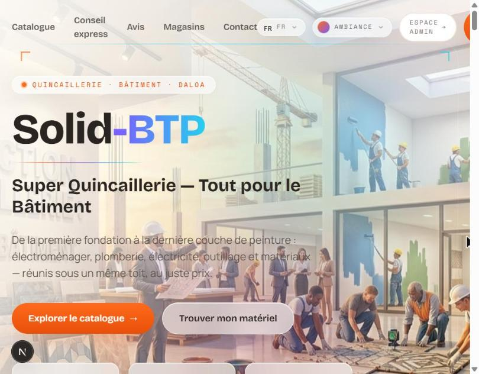
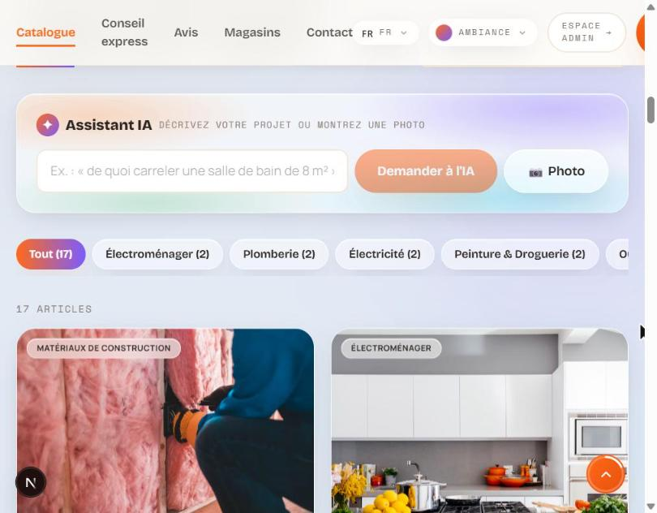
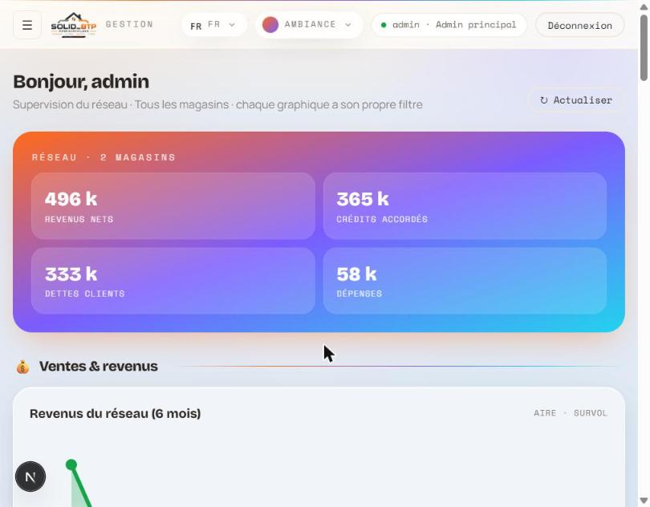

# Solid-BTP

**Storefront, AI-powered online catalogue and multi-store ERP for a building-supplies hardware store in Daloa, Côte d'Ivoire.**

*« Super Quincaillerie — Tout pour le Bâtiment »* · French-first UI · prices in CFA francs (XOF)




## Overview

Solid-BTP is a full-stack web application built for a real hardware store with several branches. It combines:

- a **public website** where customers browse the catalogue, get product advice from an AI assistant and request quotes, and
- a **back-office ERP** where the owner and store managers run day-to-day operations: invoicing, customer credit, stock, suppliers, staff and the daily cash book, across several stores.

## Features

### Public website
- **Live catalogue:** instant search, category filters with counters, and loading, empty and error states.
- **AI shopping assistant (Google Gemini):** describe a project in plain language (*"what do I need to tile an 8 m² bathroom?"*) or **upload a photo**. The assistant returns matching products that actually exist in the catalogue, each with a short justification.
- **"Conseil express" quiz:** three animated questions (project, need, budget) produce a personalised materials pack.
- **Online quote form** sent to a chosen store, plus store locations on OpenStreetMap and customer reviews.
- **10 languages** (next-intl): French, English, Arabic, Spanish, Portuguese, German, Russian, Chinese, Japanese and Swahili.
- **Four switchable themes** (including a dark mode), saved per visitor; responsive layout with a mobile menu.



### Back-office ERP (`/admin`)
A role-aware admin shell with one module per business function:

| Role | What they can do |
|---|---|
| **Store manager** | Works only in the stores assigned to them: dashboard (KPIs and charts), invoices, online quotes, customers, suppliers, stock, catalogue, employees and the daily cash book. |
| **Main admin** | Supervises the whole network: a global analytics dashboard, store and manager account management, and cross-store views of invoices, credit, suppliers and expenses. |

Highlights:
- **Typed invoices with automatic numbering per store and type:** cash, return, credit note, credit and quote. Credit and credit-note invoices **update the customer's balance automatically**. Every invoice has a printable view and a CSV export.
- **AI quote conversion:** an online quote request written in any language is turned into priced, editable invoice lines in French.
- **Multi-store stock** with purchase and sale prices, plus a cross-store lookup to see which other branches have a product.
- **Daily cash book:** customer payments, categorised expenses (fuel, day labourers, unloading, weighbridge…), staff advances and deposits, with totals, filters and export.
- **Hand-built React/SVG charts** with hover tooltips: area, bar, donut, radar and rankings. No chart library.



## Tech stack

| Layer | Choice |
|---|---|
| Framework | **Next.js 16** (App Router, Route Handlers), **React 19**, **TypeScript** |
| Styling | **Tailwind CSS**, custom glassmorphism design system, **Framer Motion** |
| Data | **PostgreSQL** with the **Prisma** ORM (migrations and seed) |
| AI | **Google Gemini** (`gemini-2.5-flash-lite`) over REST with structured JSON output |
| Auth | Custom: `scrypt` password hashing, httpOnly session cookies |
| i18n | **next-intl** (10 locales) |
| Maps | OpenStreetMap embed (no API key) |

## Security
- Passwords hashed with **scrypt**; sessions in httpOnly cookies that expire server-side after 7 days. Changing a password signs out the account's other sessions.
- **Store-level access control** (`lib/access.ts`): managers can only read or write data for the stores they are assigned.
- **Login brute-force protection:** only failed attempts count, limited per account, per IP and per account-and-IP. Unknown usernames get the same responses and timing as real ones, so the site doesn't reveal which accounts exist.
- **Per-IP rate limiting on the AI endpoints**, with forwarded-IP headers trusted only behind a known proxy.
- AI results are **re-hydrated from the database**, so the assistant can never invent products or prices.
- Excel/CSV exports are protected against formula injection.

## Getting started

**Prerequisites:** Node.js 20+, a PostgreSQL database, a [Google Gemini API key](https://aistudio.google.com/apikey).

```bash
git clone https://github.com/hussein2004-lab/Solid-BTP.git
cd Solid-BTP
npm install

cp .env.example .env      # then set DATABASE_URL and GEMINI_API_KEY
npm run db:migrate        # create the schema
npm run db:seed           # demo data: 2 stores, 16 products, stock, demo accounts
npm run dev               # http://localhost:3000
```

The admin area is at `/admin/login`. The seed creates two demo accounts: `admin` / `admin123` (main admin) and `gerant` / `gerant123` (manager of the Daloa store). **Change these passwords before any real deployment.**

Other scripts: `npm run build`, `npm start`, `npm run db:studio` (database browser).

## Project structure

```
app/
  [locale]/            public site + admin pages (localised routes)
  api/                 REST route handlers: auth, articles, invoices, customers,
                       stock, suppliers, employees, daybook, stats, ai/*
components/
  *.tsx                landing sections: Hero, Quiz, Catalogue, Testimonials, …
  admin/               ERP shell, context, shared UI, SVG charts, one module per feature
lib/
  access.ts            store-level authorisation
  invoicing.ts         invoice numbering + automatic customer balances
  gemini.ts            Gemini REST wrapper (match / propose / quote)
  rate-limit.ts        in-memory sliding-window limiter
prisma/
  schema.prisma        data model (stores, stock, invoices, customers, …)
  seed.ts              idempotent demo data
messages/              translations for the 10 locales
```

## Author

**Hussein Zaidan** · [github.com/hussein2004-lab](https://github.com/hussein2004-lab)
